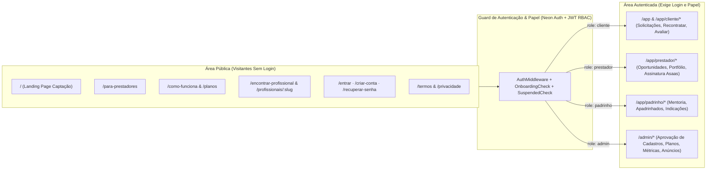

# Auditoria do Protótipo Atual e Plano de Migração para Produção (`audit-current-prototype.md`)

## 1. Stack Atual Identificada

| Camada | Tecnologia Atual no Repositório | Status Atual |
| :--- | :--- | :--- |
| **Framework Frontend** | React 19 (`react@^19.0.1`) + TypeScript 7 + Vite 8 (`vite@^8.3.0`) | SPA baseada em estado (`currentScreen` em [App.tsx](file:///e:/Anderson/Confiare/src/App.tsx)), ainda sem roteamento por URL (` pathname`). |
| **Estilização & UI** | Tailwind CSS v4 (`@tailwindcss/vite@^4.3.3`), `lucide-react`, `motion` | Design system consolidado (`#0A2540`, `#1D6FE0`, `#FF6A00`, `#F4F2EF`), tipografia limpa e responsiva. |
| **Servidor / API** | Express (`express@^4.21.2`) em [src/server/index.ts](file:///e:/Anderson/Confiare/src/server/index.ts) e [src/server/apiRouter.ts](file:///e:/Anderson/Confiare/src/server/apiRouter.ts) + Neon Function Hono em [hello.ts](file:///e:/Anderson/Confiare/hello.ts) | Implementado para planos, billing Asaas, anúncios e diagnóstico Neon; falta cobrir o CRUD de solicitações, oportunidades, avaliações, recompra e apadrinhamento. |
| **Banco de Dados** | **Neon Lakebase PostgreSQL 18** (`fancy-field-77458599`, branch `production`, região `aws-us-east-2`) + `drizzle-orm` + `pg` (`Pool`) | 10 tabelas já criadas (`plans`, `provider_profiles`, `subscriptions`, `subscription_events`, `invoices`, `opportunity_usage`, `processed_webhook_events`, `ad_slots`, `ad_impressions`, `ad_clicks`, `realtime_notifications`, `storage_assets`). Faltam as tabelas operacionais do marketplace (`users`, `profiles`, `customer_profiles`, `categories`, `provider_services`, `service_requests`, `opportunities`, `service_assignments`, `reviews`, `professional_trust_list`, `repeat_requests`, `substitute_referrals`, `mentorships`, `audit_logs`). |
| **Autenticação** | **Neon Auth (Managed Better Auth)** (`@neon/auth@^0.8.2` em [src/lib/neonClient.ts](file:///e:/Anderson/Confiare/src/lib/neonClient.ts) + `jose` JWKS em [src/server/neonServices.ts](file:///e:/Anderson/Confiare/src/server/neonServices.ts)) | Provisionado e testado na infraestrutura, porém ainda não conectado às telas de `/entrar`, `/criar-conta`, `/recuperar-senha`, onboarding e proteção de rotas privadas. |
| **Integrações** | **Asaas API v3** ([billingProvider.ts](file:///e:/Anderson/Confiare/src/services/billingProvider.ts)), **Neon Object Storage S3** (`files-sdk`), **Neon Realtime** (`@neon/realtime`), **Neon AI Gateway**, **Google AdSense Híbrido** ([GoogleModeratedAdSlot.tsx](file:///e:/Anderson/Confiare/src/components/GoogleModeratedAdSlot.tsx)) | Operacionais. Falta conector modular para E-mail Transacional, WhatsApp Business API e Geocodificação/Raio de Atendimento. |

---

## 2. Páginas, Rotas e Componentes Existentes

### 2.1. Navegação Atual no Frontend ([App.tsx](file:///e:/Anderson/Confiare/src/App.tsx))
Atualmente **não há rotas por URL** (`/entrar`, `/app`, `/admin`, etc.). Todas as 11 telas são renderizadas condicionalmente na mesma URL (`/`) através do seletor `"Fluxos do Protótipo:"`:
1. `home` — [HomeScreen.tsx](file:///e:/Anderson/Confiare/src/components/HomeScreen.tsx) (mistura seção Hero com um mapa de navegação interna das 9 telas do protótipo).
2. `cadastro-cliente` — [AuthRegistrationScreens.tsx](file:///e:/Anderson/Confiare/src/components/AuthRegistrationScreens.tsx) (formulário em memória sem criar usuário real no Neon Auth).
3. `cadastro-prestador` — [AuthRegistrationScreens.tsx](file:///e:/Anderson/Confiare/src/components/AuthRegistrationScreens.tsx) (formulário em memória sem upload real de documentos para o bucket `assets`).
4. `criar-solicitacao` — [ServiceRequestAndListScreens.tsx](file:///e:/Anderson/Confiare/src/components/ServiceRequestAndListScreens.tsx) (adiciona pedido apenas no `useState` de `App.tsx`).
5. `profissionais-compativeis` — [ServiceRequestAndListScreens.tsx](file:///e:/Anderson/Confiare/src/components/ServiceRequestAndListScreens.tsx) (filtra `INITIAL_PROVIDERS` em memória).
6. `perfil-prestador` — [ProviderProfileAndRepeatScreens.tsx](file:///e:/Anderson/Confiare/src/components/ProviderProfileAndRepeatScreens.tsx) (possui um `<select>` de protótipo para alternar entre prestadores).
7. `solicitar-novamente` — [ProviderProfileAndRepeatScreens.tsx](file:///e:/Anderson/Confiare/src/components/ProviderProfileAndRepeatScreens.tsx) (simula aceitação ou indisponibilidade com botões de demonstração).
8. `indicacao-substituto` — [SubstituteAndReviewScreens.tsx](file:///e:/Anderson/Confiare/src/components/SubstituteAndReviewScreens.tsx) (possui um botão de alternância de perspectiva `"Visão do Cliente"` vs `"Visão do Prestador"` na mesma tela).
9. `avaliacao-pos-atendimento` — [SubstituteAndReviewScreens.tsx](file:///e:/Anderson/Confiare/src/components/SubstituteAndReviewScreens.tsx) (atualiza nota apenas em memória no estado React).
10. `painel-prestador` — [ProviderDashboardScreen.tsx](file:///e:/Anderson/Confiare/src/components/ProviderDashboardScreen.tsx) (acessível sem login).
11. `painel-admin` — [AdminMonetizationScreen.tsx](file:///e:/Anderson/Confiare/src/components/AdminMonetizationScreen.tsx) (acessível sem login pelo menu superior).

### 2.2. Rotas de API Existentes ([src/server/apiRouter.ts](file:///e:/Anderson/Confiare/src/server/apiRouter.ts))
- `GET /api/plans`
- `GET /api/providers/:providerId/subscription`
- `POST /api/subscriptions/checkout`
- `POST /api/subscriptions/:id/upgrade`
- `POST /api/subscriptions/:id/downgrade`
- `POST /api/subscriptions/:id/cancel`
- `POST /api/webhooks/billing`
- `POST /api/opportunities/dispatch`
- `GET /api/ads/provider-panel`, `POST /api/ads/:adId/impression`, `POST /api/ads/:adId/click`, `GET /api/ads/ads.txt`
- `GET /api/admin/metrics`, `GET /api/admin/subscriptions`, `PATCH /api/admin/plans/:id`, `GET /api/admin/ads`, `POST /api/admin/ads`, `PATCH /api/admin/ads/:adId`, `DELETE /api/admin/ads/:adId`, `PATCH /api/admin/ads/google-config`
- `GET /api/neon/postgres`, `POST /api/neon/auth`, `POST /api/neon/storage`, `POST /api/neon/ai-gateway`, `GET /api/neon/functions`, `POST /api/neon/realtime/seal`, `POST /api/neon/realtime/test`, `GET /api/neon/verify-all`

### 2.3. Componentes Reutilizáveis Existentes
- [ConfiareLogo.tsx](file:///e:/Anderson/Confiare/src/components/ConfiareLogo.tsx): logotipo vetorial (`dark-text` / `light-text`) e ilustrações de portfólio Antes/Depois (`PortfolioVisualGraphic`).
- [GoogleModeratedAdSlot.tsx](file:///e:/Anderson/Confiare/src/components/GoogleModeratedAdSlot.tsx): banner publicitário moderado com suporte híbrido e `NPA=1`.
- [ProviderRealtimeNotifications.tsx](file:///e:/Anderson/Confiare/src/components/ProviderRealtimeNotifications.tsx): central de notificações com filtro por tipo e marcação de leitura.
- [ marketplaceRules.ts](file:///e:/Anderson/Confiare/src/utils/marketplaceRules.ts): motor de cálculo de `calculateCompositeScore`, `getMatchingPriority`, `rankCompatibleProviders` e `validateSubstituteSelection`.

---

## 3. Dados Atualmente Fictícios / em Memória

1. **[src/data/seedData.ts](file:///e:/Anderson/Confiare/src/data/seedData.ts)**:
   - `CATEGORIES_LIST` (5 categorias estáticas).
   - `INITIAL_PROVIDERS` (`prov-joao`, `prov-carlos`, `prov-ana`, `prov-marcos`, `prov-roberto`) com portfólios e avaliações hardcoded.
   - `INITIAL_SERVICE_REQUESTS`, `INITIAL_PROVIDER_OPPORTUNITIES`, `INITIAL_SUBSTITUTE_REFERRAL`, `INITIAL_PROVIDER_NOTIFICATIONS`.
2. **Estado em [src/App.tsx](file:///e:/Anderson/Confiare/src/App.tsx)**:
   - `clientProfile` hardcoded como `"Mariana Souza"` (`mariana.souza@email.com.br`, `(11) 99204-6612`).
   - Qualquer solicitação criada, substituto indicado ou avaliação enviada é perdida ao recarregar a página (`F5`), pois não grava no banco PostgreSQL.

---

## 4. Auditoria de Segurança: Vulnerabilidades e Exposições Identificadas

> [!CAUTION]
> **Falhas Críticas Identificadas no Protótipo que Serão Corrigidas na Migração:**

1. **Exposição de Dados Sensíveis (PII / WhatsApp) no Frontend antes do Consentimento**:
   - Em [seedData.ts](file:///e:/Anderson/Confiare/src/data/seedData.ts#L597-L639) e [ProviderDashboardScreen.tsx](file:///e:/Anderson/Confiare/src/components/ProviderDashboardScreen.tsx#L323-L327), o objeto `ProviderOpportunity` trafega para o navegador contendo `clientNameFull` e `clientWhatsapp` mesmo quando `status === 'pendente'`. A ocultação é apenas visual no React!
   - Em [ProviderProfileAndRepeatScreens.tsx](file:///e:/Anderson/Confiare/src/components/ProviderProfileAndRepeatScreens.tsx#L37), o WhatsApp do prestador já está no bundle do cliente e o botão `"Liberar contato no WhatsApp"` apenas muda um booleano local `whatsappUnlocked = true` sem registrar consentimento LGPD nem verificar autenticação.
   - **Correção**: A API de oportunidades omitirá `clientNameFull` e `clientWhatsapp` no JSON até que haja aceite da oportunidade pelo prestador **e** consentimento explícito do cliente registrado no banco.

2. **Falsificação de Papel Administrativo via Header (`x-user-role: admin`)**:
   - Em [apiRouter.ts](file:///e:/Anderson/Confiare/src/server/apiRouter.ts#L59-L71), `requireAdminRole` verifica apenas `req.headers['x-user-role'] === 'admin'`. Qualquer cliente HTTP pode enviar esse header e acessar `/api/admin/*`.
   - **Correção**: Implementar middleware `requireAuth` e `requireRole(['admin'])` que valida criptograficamente o JWT emitido pelo **Neon Auth** (`verifyNeonAuthJwt` via `NEON_AUTH_JWKS_URL`) ou sessão assinada e confere o papel real do usuário na tabela `users` / `profiles` no PostgreSQL.

3. **Rotas Privadas e de Mutação sem Autenticação JWT**:
   - Rotas como `POST /api/subscriptions/checkout`, `POST /api/subscriptions/:id/upgrade`, `/downgrade`, `/cancel` e `POST /api/opportunities/dispatch` não validam o token do usuário autenticado.
   - Rotas de diagnóstico `/api/neon/*` (`POST /api/neon/auth`, `POST /api/neon/storage`, `GET /api/neon/verify-all`) estão abertas sem autenticação e criam registros no banco/storage.
   - **Correção**: Proteger todas as rotas `/api/app/*` e `/api/admin/*` com middleware JWT/Sessão + RBAC por papel (`cliente`, `prestador`, `padrinho`, `admin`) e restringir `/api/neon/*` apenas a administradores ou ambiente de teste.

4. **Mistura de Visões no Frontend (Cliente, Prestador e Admin na Mesma Tela)**:
   - O topo da página exibe `"Fluxos do Protótipo"`, expondo o Painel do Prestador e o Painel Admin para visitantes anônimos.
   - A tela de Indicação de Substituto permite alternar entre `"Visão do Cliente"` e `"Visão do Prestador"`.
   - **Correção**: Remover a barra `"Fluxos do Protótipo"` e implementar roteamento real separando **Área Pública** (`/`, `/encontrar-profissional`, `/profissionais/:slug`, `/como-funciona`, `/para-prestadores`, `/planos`, `/entrar`, `/criar-conta`, `/recuperar-senha`, `/termos`, `/privacidade`) e **Área Autenticada Protegida** (`/app`, `/app/cliente/*`, `/app/prestador/*`, `/app/padrinho/*`, `/admin/*`).

5. **Controle de Acesso a Dados (RLS / Isolamento por Papel no PostgreSQL)**:
   - O projeto usa **Neon Lakebase Postgres** (e **Neon Realtime**, que requer tabelas sem RLS nativo do Postgres para conexões Live SQL, ou políticas aplicadas na camada de dados/views).
   - **Correção**: Implementar políticas estritas de isolamento por `user_id` / `role` em todas as consultas e transações do backend + políticas RLS nas tabelas sensíveis que não usam Live SQL direto (`audit_logs`, documentos de verificação em `storage_assets`), garantindo que:
     - Cliente só acesse seus próprios pedidos (`service_requests`), histórico (`repeat_requests`) e avaliações (`reviews`).
     - Prestador só acesse suas oportunidades (`opportunities`), perfil, reputação e assinatura.
     - Padrinho só acesse seus apadrinhados autorizados (`mentorships`).
     - Documentos de verificação no Neon Object Storage (`assets` bucket privado) só gerem URL pré-assinada para o prestador dono ou `admin`.

6. **Verificação de Chaves e Segredos Expostos**:
   - Auditoria confirmou que `.env.local` (`DATABASE_URL`, `ASAAS_API_KEY`, `NEON_REALTIME_SECRET`, `AWS_SECRET_ACCESS_KEY`) está protegido pelo `.gitignore` e **não foi exposto no bundle frontend** (apenas `VITE_NEON_AUTH_URL`, `VITE_NEON_REALTIME_URL` e `VITE_GOOGLE_ADSENSE_*` são públicos no Vite).

---

## 5. Arquitetura Alvo: Área Pública vs. Área Autenticada

---

## 6. Modelagem Completa do Banco de Produção (19 Tabelas com UUID e Timestamps TZ)

Todas as 19 tabelas exigidas serão criadas/validadas no **Neon PostgreSQL** com chaves primárias, `TIMESTAMPTZ`, `FOREIGN KEYS`, `CHECK CONSTRAINTS`, soft delete (`deleted_at`) onde aplicável e índices de busca (`categoria`, `cidade`, `bairro`, `status`, `created_at`):

1. `users` (`id` UUID PK, `neon_auth_user_id` UNIQUE, `email` UNIQUE, `roles` TEXT[] — permite ser `cliente` e `prestador` simultaneamente, `active_role`, `status` `'pendente_confirmacao' | 'ativo' | 'suspenso'`, `email_verified`, `onboarding_completed`, `created_at`, `updated_at`, `deleted_at`)
2. `profiles` (`id` UUID PK, `user_id` FK -> `users.id`, `full_name`, `phone`, `avatar_object_key`, `city`, `neighborhood`, `lgpd_consent`, `lgpd_consent_at`, `created_at`, `updated_at`)
3. `customer_profiles` (`id` UUID PK, `user_id` FK -> `users.id`, `favorite_categories` TEXT[], `preferred_contact`, `created_at`, `updated_at`)
4. `provider_profiles` (`id` UUID/TEXT PK, `user_id` FK -> `users.id`, `slug` UNIQUE, `professional_name`, `category_id`, `category`, `city`, `neighborhoods` TEXT[], `radius_km`, `lat`, `lng`, `years_experience`, `bio`, `plan_slug`, `rating_avg`, `reviews_count`, `completed_jobs`, `response_time_minutes`, `response_rate_percent`, `attendance_rate_percent`, `profile_completeness_percent`, `is_verified`, `verification_status` `'pendente' | 'aprovado' | 'rejeitado'`, `document_object_key`, `address_proof_object_key`, `is_top_region`, `is_mentor`, `mentor_id`, `available_today`, `whatsapp`, `created_at`, `updated_at`, `deleted_at`)
5. `categories` (`id` UUID PK, `slug` UNIQUE, `name` UNIQUE, `short_desc`, `common_problems` TEXT[], `avg_response_min`, `active`, `created_at`)
6. `provider_services` (`id` UUID PK, `provider_profile_id` FK, `category_id` FK, `title`, `description`, `before_after_label`, `duration`, `visual_type`, `photo_object_key`, `created_at`)
7. `service_requests` (`id` UUID PK, `customer_user_id` FK -> `users.id`, `category_id` FK, `category_name`, `problem_title`, `description`, `neighborhood`, `city`, `lat`, `lng`, `urgency`, `preferred_time`, `estimated_budget`, `preferred_previous_provider_id`, `lgpd_contact_consent`, `photos_count`, `status` `'em_matching' | 'oportunidades_enviadas' | 'prestador_interessado' | 'contato_liberado' | 'concluido' | 'cancelado'`, `created_at`, `updated_at`, `deleted_at`)
8. `opportunities` (`id` UUID PK, `service_request_id` FK -> `service_requests.id`, `provider_profile_id` FK -> `provider_profiles.id`, `origin`, `referred_by_provider_id`, `distance_km`, `expires_at`, `status` `'pendente' | 'aceita' | 'recusada' | 'substituto_indicado' | 'expirada'`, `decline_reason`, `contact_released`, `contact_released_at`, `responded_at`, `created_at`)
9. `service_assignments` (`id` UUID PK, `service_request_id` FK, `opportunity_id` FK, `provider_profile_id` FK, `customer_user_id` FK, `status` `'em_orcamento' | 'agendado' | 'concluido' | 'cancelado'`, `scheduled_for`, `completed_at`, `created_at`)
10. `reviews` (`id` UUID PK, `service_assignment_id` FK, `service_request_id` FK, `provider_profile_id` FK, `customer_user_id` FK, `client_name_display`, `neighborhood`, `service_title`, `rating`, `qualidade`, `pontualidade`, `comunicacao`, `organizacao`, `would_recommend`, `comment`, `provider_reply`, `created_at`)
11. `professional_trust_list` (`id` UUID PK, `customer_user_id` FK -> `users.id`, `provider_profile_id` FK -> `provider_profiles.id`, `last_service_date`, `last_service_summary`, `times_hired`, `created_at`)
12. `repeat_requests` (`id` UUID PK, `customer_user_id` FK, `provider_profile_id` FK, `category_name`, `service_type`, `desired_date`, `urgency`, `notes`, `lgpd_share_consent`, `status` `'solicitado' | 'aceito' | 'indisponivel_com_substituto'`, `created_at`)
13. `substitute_referrals` (`id` UUID PK, `repeat_request_id` FK, `service_request_id` FK, `original_provider_id` FK, `substitute_provider_ids` TEXT[], `reason_category`, `custom_note`, `service_context`, `neighborhood`, `urgency`, `client_consent_shared`, `client_accepted_provider_id`, `created_at`)
14. `mentorships` (`id` UUID PK, `mentor_provider_id` FK -> `provider_profiles.id`, `mentee_provider_id` FK -> `provider_profiles.id`, `mentor_code`, `status` `'ativo' | 'pausado' | 'encerrado'`, `created_at`)
15. `plans` (já implementada e validada)
16. `subscriptions` + `subscription_events` + `opportunity_usage` + `processed_webhook_events` (já implementadas)
17. `invoices` (já implementada)
18. `notifications` (`id` UUID PK, `user_id` FK, `provider_profile_id` FK, `type`, `title`, `message`, `client_name`, `neighborhood`, `urgency_or_scope`, `opportunity_id`, `read`, `created_at`)
19. `audit_logs` (`id` UUID PK, `actor_user_id`, `actor_role`, `action`, `target_type`, `target_id`, `metadata_json` JSONB, `ip_address`, `created_at`)

---

## 7. Ordem de Implementação (Após sua Aprovação)

1. **Etapa 1 — Banco de Dados de Produção (19 Tabelas + Índices + Constraints + RLS/Políticas de Acesso)**
   - Migração SQL/Drizzle idempotente criando todas as 19 tabelas, índices de busca (`categoria`, `cidade`, `bairro`, `status`, `data`), constraints e seed exclusivo para ambiente de desenvolvimento (`NODE_ENV !== 'production'`).
2. **Etapa 2 — Autenticação Real (Neon Auth + Sessão JWT + Papéis Múltiplos + Onboarding + Bloqueio de Suspensos)**
   - Fluxos completos de `/criar-conta` (escolha `"Sou cliente"` ou `"Sou prestador"`, ou ambos), confirmação de e-mail, `/entrar` (e-mail/senha + login social Google via Neon Auth), `/recuperar-senha`, onboarding obrigatório no primeiro acesso e redirecionamento automático por papel (`/app`, `/app/prestador`, `/app/padrinho`, `/admin`).
3. **Etapa 3 — Segurança Backend (Middlewares JWT/RBAC, Proteção de Contatos LGPD, Sanitização, Rate Limit, Headers HTTP e `audit_logs`)**
   - Fechamento de todas as rotas privadas, mascaramento real no backend do WhatsApp do cliente até o aceite + consentimento LGPD, controle de acesso a documentos privados no Neon Object Storage e gravação automática em `audit_logs`.
4. **Etapa 4 — Roteamento Público vs. Autenticado e Novas Páginas Públicas (`/` Landing Page, `/para-prestadores`, `/como-funciona`, `/planos`, `/encontrar-profissional`, `/profissionais/[slug]`, `/termos`, `/privacidade`)**
   - Reestruturação da Home como Landing Page pública de alta conversão (com todas as 14 seções solicitadas), página `/para-prestadores` dedicada e vitrine pública por slug (`/profissionais/joao-batista-silva`).
5. **Etapa 5 — Áreas Autenticadas Reais (`/app`, `/app/cliente/*`, `/app/prestador/*`, `/app/padrinho/*`, `/admin/*`) Conectadas ao PostgreSQL**
   - Persistência real de solicitações de serviço, envio de oportunidades aos prestadores compatíveis, liberação de contato auditada, recontratação em 1 clique, indicação de substituto com consentimento, avaliação pós-atendimento recalculando a nota no banco, painel do Padrinho e aprovação administrativa de cadastros.
6. **Etapa 6 — Integrações Essenciais (E-mail Transacional, WhatsApp Business API, Geocodificação/Raio) e Preparação para Deploy Público**
   - Conectores de e-mail transacional, WhatsApp Business Cloud API / Z-API e cálculo geográfico de distância/raio, configuração de deploy (Vercel / Neon Functions, HTTPS, headers de segurança) e suíte completa de testes E2E validando todos os critérios de aceite.

---

Os documentos complementares [migration-plan.md](file:///e:/Anderson/Confiare/migration-plan.md) e [security-checklist.md](file:///e:/Anderson/Confiare/security-checklist.md) também foram gerados na raiz do projeto. **Aguardo sua aprovação deste plano para iniciar a implementação passo a passo.**
