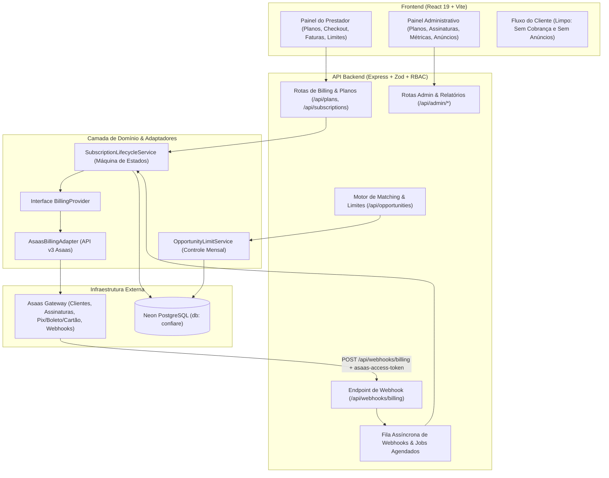
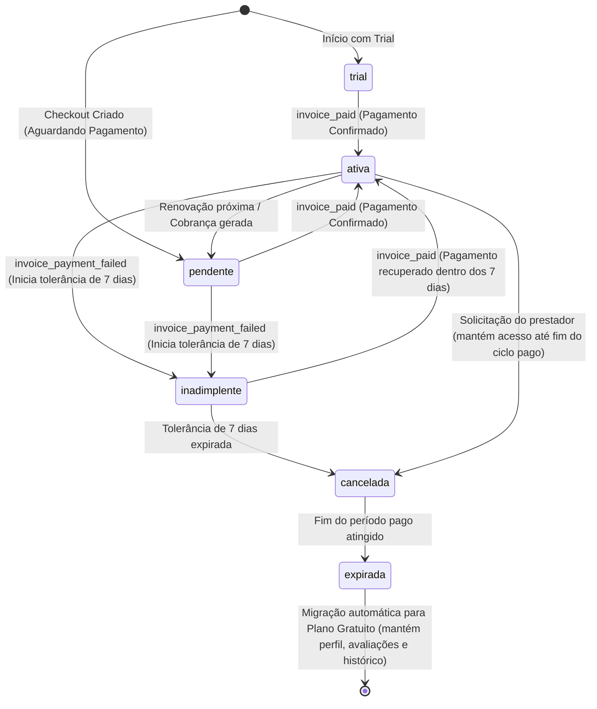

# Plano de Implementação — Módulo de Monetização, Assinaturas (Asaas) e Limites (Confiare + Neon DB)

## 0. Diagnóstico do Repositório Atual e Análise de Impacto

Antes de qualquer alteração de código, foi realizada a auditoria completa do repositório atual:

### 0.1. Stack Identificada
- **Frontend**: React 19 (`react@^19.0.1`), TypeScript (`typescript@^7.0.2`), Vite 8 (`vite@^8.3.0`), Tailwind CSS v4 (`@tailwindcss/vite@^4.3.3`), ícones `lucide-react` e animações `motion`.
- **Backend / Runtime**: `express@^4.21.2`, `dotenv@^17.2.3` e `tsx@^4.21.0` já constam no [package.json](file:///e:/Anderson/Confiare/package.json), porém **ainda não há servidor Express (`src/server`), banco de dados configurado nem Prisma ORM instalado**.
- **Testes**: Executor nativo do Node.js (`node:test` e `node:assert/strict`) em [marketplaceRules.test.ts](file:///e:/Anderson/Confiare/src/utils/marketplaceRules.test.ts).

### 0.2. Modelo de Dados e Regras Existentes
- **Tipos ([confiare.ts](file:///e:/Anderson/Confiare/src/types/confiare.ts))**:
  - `PlanTier`: atualmente `'Essencial' | 'Profissional' | 'Premium' | 'Padrinho'` (sem `'Gratuito'`).
  - Entidades em memória: `ProviderProfile`, `PortfolioItem`, `ReviewItem`, `ServiceRequest`, `RepeatServiceRequest`, `SubstituteReferral`, `ProviderOpportunity`, `ProviderRealtimeNotification`, `ClientRegistration`, `ProviderRegistration`.
- **Dados Iniciais ([seedData.ts](file:///e:/Anderson/Confiare/src/data/seedData.ts))**:
  - 5 categorias de serviço, prestadores verificados iniciais, solicitações e oportunidades mockadas.
- **Regras de Negócio ([marketplaceRules.ts](file:///e:/Anderson/Confiare/src/utils/marketplaceRules.ts))**:
  - `calculateCompositeScore`: nota composta (40% avaliações, 20% tempo de resposta, 20% taxa de resposta, 10% trabalhos concluídos, 10% verificação/completude).
  - `rankCompatibleProviders`: combina compatibilidade (0–40), disponibilidade (0–20), reputação (0–35), bônus do plano (`PLAN_PRIORITY_BONUS`) e penalidades.
  - `validateSubstituteSelection`, `applyNewReviewToProvider` e gerenciamento de notificações em tempo real.

### 0.3. Rotas e Telas Existentes
- **Rotas de API**: Nenhuma rota HTTP/Express implementada até o momento.
- **Telas no Frontend ([App.tsx](file:///e:/Anderson/Confiare/src/App.tsx))**:
  1. `home` ([HomeScreen.tsx](file:///e:/Anderson/Confiare/src/components/HomeScreen.tsx))
  2. `cadastro-cliente` ([AuthRegistrationScreens.tsx](file:///e:/Anderson/Confiare/src/components/AuthRegistrationScreens.tsx))
  3. `cadastro-prestador` ([AuthRegistrationScreens.tsx](file:///e:/Anderson/Confiare/src/components/AuthRegistrationScreens.tsx))
  4. `criar-solicitacao` ([ServiceRequestAndListScreens.tsx](file:///e:/Anderson/Confiare/src/components/ServiceRequestAndListScreens.tsx))
  5. `profissionais-compativeis` ([ServiceRequestAndListScreens.tsx](file:///e:/Anderson/Confiare/src/components/ServiceRequestAndListScreens.tsx))
  6. `perfil-prestador` ([ProviderProfileAndRepeatScreens.tsx](file:///e:/Anderson/Confiare/src/components/ProviderProfileAndRepeatScreens.tsx))
  7. `solicitar-novamente` ([ProviderProfileAndRepeatScreens.tsx](file:///e:/Anderson/Confiare/src/components/ProviderProfileAndRepeatScreens.tsx))
  8. `indicacao-substituto` ([SubstituteAndReviewScreens.tsx](file:///e:/Anderson/Confiare/src/components/SubstituteAndReviewScreens.tsx))
  9. `avaliacao-pos-atendimento` ([SubstituteAndReviewScreens.tsx](file:///e:/Anderson/Confiare/src/components/SubstituteAndReviewScreens.tsx))
  10. `painel-prestador` ([ProviderDashboardScreen.tsx](file:///e:/Anderson/Confiare/src/components/ProviderDashboardScreen.tsx))

### 0.4. Impacto sobre Funcionalidades Existentes (Sem Sobrescrita Destrutiva)
> [!IMPORTANT]
> Nenhuma jornada existente de cliente ou prestador será removida. Os impactos mapeados são:
> 1. **`PlanTier` em [confiare.ts](file:///e:/Anderson/Confiare/src/types/confiare.ts)**: adição de `'Gratuito'` ao union type (`'Gratuito' | 'Essencial' | 'Profissional' | 'Premium' | 'Padrinho'`) e criação do tipo `PlanSlug` (`'gratuito' | 'essencial' | 'profissional' | 'premium' | 'padrinho'`).
> 2. **Tabela de Preços e Limites em [ProviderDashboardScreen.tsx](file:///e:/Anderson/Confiare/src/components/ProviderDashboardScreen.tsx#L43-L94)**: atualmente exibe valores estáticos antigos (R$ 49 / R$ 89 / R$ 139 / R$ 109). Será atualizada para refletir os **5 planos oficiais** (Gratuito R$ 0, Essencial R$ 29,90, Profissional R$ 59,90, Premium R$ 99,90, Padrinho R$ 99,90) carregados do seed/API, com suporte a ciclo mensal/anual, barra de consumo de oportunidades, avisos de tolerância/limite e faturas.
> 3. **Motor de Matching em [marketplaceRules.ts](file:///e:/Anderson/Confiare/src/utils/marketplaceRules.ts)**: `rankCompatibleProviders` manterá sua assinatura atual para não quebrar componentes nem os testes em [marketplaceRules.test.ts](file:///e:/Anderson/Confiare/src/utils/marketplaceRules.test.ts), passando a delegar o cálculo para a nova função central `getMatchingPriority(providerProfile, context)` e respeitando o bloqueio de envio de novas oportunidades quando o prestador atingir o limite mensal (`opportunity_usage`).
> 4. **Banco Neon PostgreSQL**: identificamos o projeto Neon `late-sound-84180998` (região `aws-sa-east-1`, PG 18). Como o banco padrão `neondb` contém tabelas de outro projeto (`flyers_gerados`, `brand_dna`), criaremos um **banco de dados isolado chamado `confiare`** dentro do projeto Neon (ou um novo projeto Neon se preferir), garantindo zero conflito com dados existentes.

---

## 1. Arquitetura do Módulo de Billing (Asaas + Neon PostgreSQL)

### 1.1. Desacoplamento do Gateway (`BillingProvider`)
- A interface `BillingProvider` define o contrato agnóstico de gateway:
  - `createCustomer(input)`
  - `createSubscription(input)`
  - `updateSubscription(subscriptionId, input)`
  - `cancelSubscription(subscriptionId, reason?)`
  - `createCheckoutSession(input)`
  - `createBillingPortalSession(customerId)`
  - `handleWebhook(rawBody, headers)`
  - `getInvoice(gatewayInvoiceId)`
  - `refundInvoice(gatewayInvoiceId, amountCents?)`
- **Implementação `AsaasBillingAdapter`**:
  - Usa a API v3 do Asaas (`ASAAS_API_URL` sandbox/produção, `ASAAS_API_KEY` no header `access_token`).
  - Suporta cobrança via `PIX`, `CREDIT_CARD` e `BOLETO` (ou `UNDEFINED` no link de checkout Asaas para o prestador escolher no checkout).
  - Valida autenticidade do webhook via header `asaas-access-token` comparado com `ASAAS_WEBHOOK_TOKEN` (em tempo constante `crypto.timingSafeEqual`).
  - Traduz eventos nativos do Asaas (`PAYMENT_CREATED`, `PAYMENT_CONFIRMED`, `PAYMENT_RECEIVED`, `PAYMENT_OVERDUE`, `PAYMENT_DELETED`, `PAYMENT_REFUNDED`, `SUBSCRIPTION_CREATED`, `SUBSCRIPTION_UPDATED`, `SUBSCRIPTION_INACTIVATED`, `SUBSCRIPTION_DELETED`) para os eventos canônicos da Confiare.
  - Possui modo fallback/mock determinístico para execução de testes automatizados sem depender de rede externa.

---

## 2. Modelo de Dados Completo (Prisma + Neon PostgreSQL)

Todos os valores monetários são armazenados em **centavos (`Int`)**. Nenhum valor monetário usa `Float`.

### 2.1. Tabelas e Enums (`prisma/schema.prisma`)

1. **`provider_profiles`** (persistência dos prestadores para chaves estrangeiras e métricas):
   - `id` (UUID/String PK), `nome`, `email`, `telefone`, `cpf_cnpj`, `categoria`, `cidade`, `bairros` (String[]), `nota_media`, `total_avaliacoes`, `servicos_concluidos`, `tempo_resposta_min`, `taxa_resposta_pct`, `taxa_comparecimento_pct`, `completude_perfil_pct`, `verificado` (Boolean), `disponivel_hoje` (Boolean), `criado_em`, `atualizado_em`.

2. **`plans`**:
   - `id` (String PK UUID)
   - `slug` (Unique: `gratuito` | `essencial` | `profissional` | `premium` | `padrinho`)
   - `nome` (String)
   - `descricao` (String)
   - `preco_mensal_centavos` (Int)
   - `preco_anual_centavos` (Int)
   - `limite_oportunidades_mensal` (Int)
   - `prioridade_matching` (Int — bônus moderado configurável: Gratuito=0, Essencial=2, Profissional=5, Premium=8, Padrinho=9)
   - `permite_destaque` (Boolean)
   - `permite_relatorios_avancados` (Boolean)
   - `permite_portfolio_ilimitado` (Boolean)
   - `max_fotos_portfolio` (Int? — `0` ou básico no Gratuito, `10` no Essencial, `null` para ilimitado)
   - `exibe_anuncios` (Boolean — `true` apenas no `gratuito`)
   - `selo` (String? — ex: `"Profissional Confiare"`, `"Top Confiare"`, `"Padrinho Verificado"`)
   - `ativo` (Boolean)
   - `ordem_exibicao` (Int)
   - `criado_em` (DateTime), `atualizado_em` (DateTime)

3. **`subscriptions`**:
   - `id` (String PK UUID)
   - `provider_profile_id` (String FK -> `provider_profiles.id`)
   - `plan_id` (String FK -> `plans.id`)
   - `scheduled_plan_id` (String? FK -> `plans.id` — usado para downgrade agendado para o fim do ciclo)
   - `status` (`trial` | `ativa` | `pendente` | `inadimplente` | `cancelada` | `expirada`)
   - `ciclo` (`mensal` | `anual`)
   - `inicio` (DateTime)
   - `fim` (DateTime)
   - `proxima_cobranca` (DateTime?)
   - `tolerancia_ate` (DateTime? — preenchido com `now + 7 dias` quando entra em `inadimplente`)
   - `gateway_subscription_id` (String? Unique)
   - `gateway_customer_id` (String?)
   - `cancelada_em` (DateTime?)
   - `motivo_cancelamento` (String?)
   - `criado_em` (DateTime), `atualizado_em` (DateTime)

4. **`subscription_events`** (Auditoria e histórico imutável):
   - `id` (String PK UUID)
   - `subscription_id` (String FK -> `subscriptions.id`)
   - `evento` (String — `subscription_created`, `subscription_activated`, `subscription_updated`, `subscription_canceled`, `subscription_expired`, `invoice_created`, `invoice_paid`, `invoice_payment_failed`, `trial_will_end`, `payment_method_updated`, `plan_upgraded`, `plan_downgrade_scheduled`)
   - `dados_anteriores_json` (Json?)
   - `dados_novos_json` (Json?)
   - `gateway_event_id` (String?)
   - `processado_em` (DateTime)
   - `criado_em` (DateTime)

5. **`invoices`**:
   - `id` (String PK UUID)
   - `subscription_id` (String FK -> `subscriptions.id`)
   - `valor_centavos` (Int)
   - `status` (`pendente` | `paga` | `falhou` | `estornada` | `cancelada`)
   - `metodo` (`pix` | `cartao` | `boleto`)
   - `vencimento` (DateTime)
   - `pago_em` (DateTime?)
   - `gateway_invoice_id` (String? Unique)
   - `url_checkout` (String?)
   - `criado_em` (DateTime), `atualizado_em` (DateTime)

6. **`opportunity_usage`**:
   - `id` (String PK UUID)
   - `provider_profile_id` (String FK)
   - `subscription_id` (String FK)
   - `periodo_inicio` (DateTime)
   - `periodo_fim` (DateTime)
   - `oportunidades_utilizadas` (Int, default `0`)
   - `criado_em` (DateTime), `atualizado_em` (DateTime)
   - Índice composto em `(provider_profile_id, periodo_inicio, periodo_fim)`

7. **`processed_webhook_events`**:
   - `id` (String PK UUID)
   - `gateway` (String, default `'asaas'`)
   - `event_id` (String Unique)
   - `tipo_evento` (String)
   - `payload_hash` (String)
   - `payload_raw` (Json?)
   - `status` (`recebido` | `processado` | `falhou` | `ignorado`)
   - `erro` (String?)
   - `processado_em` (DateTime?)
   - `criado_em` (DateTime)

8. **`ad_slots`**, **`ad_impressions`** e **`ad_clicks`**:
   - Modeladas no schema desde a migração inicial para integridade do banco, mas suas rotas/telas serão implementadas somente na Etapa 10 (após todo o fluxo de assinatura e limites estar validado e testado).

### 2.2. Matriz de Seed Inicial dos 5 Planos

| Ordem | Slug | Nome | Mensal (centavos) | Anual (centavos) | Limite Oport./Mês | Prioridade Matching | Destaque | Relatórios Avançados | Portfólio Ilimitado | Exibe Anúncios | Selo |
| :--- | :--- | :--- | :---: | :---: | :---: | :---: | :---: | :---: | :---: | :---: | :--- |
| 1 | `gratuito` | Gratuito | `0` (R$ 0,00) | `0` (R$ 0,00) | `5` | `0` | `false` | `false` | `false` | `true` | — |
| 2 | `essencial` | Essencial | `2990` (R$ 29,90) | `29900` (R$ 299,00) | `15` | `2` | `false` | `false` | `false` (até 10 fotos) | `false` | — |
| 3 | `profissional` | Profissional | `5990` (R$ 59,90) | `59900` (R$ 599,00) | `40` | `5` | `true` | `false` | `true` | `false` | Profissional Confiare |
| 4 | `premium` | Premium | `9990` (R$ 99,90) | `99900` (R$ 999,00) | `100` | `8` | `true` | `true` | `true` | `false` | Top Confiare |
| 5 | `padrinho` | Padrinho | `9990` (R$ 99,90) | `99900` (R$ 999,00) | `100` | `9` | `true` | `true` | `true` | `false` | Padrinho Verificado |

---

## 3. Máquina de Estados e Ciclo de Vida da Assinatura

### Regras Críticas do Ciclo de Vida:
1. **Tolerância de 7 dias na Inadimplência**:
   - Ao receber `invoice_payment_failed` (`PAYMENT_OVERDUE` no Asaas), o status muda para `inadimplente` e `tolerancia_ate = now + 7 dias`.
   - Durante esses 7 dias, o prestador **mantém acesso aos recursos e limites do plano atual**, mas vê um aviso claro de pagamento pendente com link direto para regularização (`url_checkout`).
   - Se a tolerância expirar sem pagamento, o job agendado transiciona a assinatura para `cancelada` -> `expirada` e cria/ativa automaticamente uma assinatura no plano `gratuito`, **sem jamais excluir perfil, portfólio, avaliações ou histórico**.
2. **Cancelamento Livre sem Multa**:
   - Quando o prestador solicita cancelamento, `status = cancelada` e `cancelada_em = now`, mas o prestador mantém os benefícios do plano pago até `fim` (data de término do período já pago).
   - Ao atingir `fim`, a assinatura passa para `expirada` e a conta migra automaticamente para o plano `gratuito`.
3. **Upgrade vs. Downgrade**:
   - **Upgrade** (ex: `essencial` → `profissional` ou `mensal` → `anual`): efeito **imediato** nos benefícios e no novo limite mensal de oportunidades, cobrando a diferença proporcional (`pro-rata` em centavos) mantendo a data de renovação estável.
   - **Downgrade** (ex: `premium` → `essencial`): agendado via `scheduled_plan_id` para entrar em vigor apenas na próxima renovação (`fim`), preservando o plano atual até o último dia pago e informando a data exata da mudança.

---

## 4. Fluxo de Assinatura e Fluxo de Webhooks

### 4.1. Fluxo de Assinatura (Checkout Asaas)
1. Prestador seleciona plano (`essencial`, `profissional`, `premium` ou `padrinho`), ciclo (`mensal` ou `anual`) e forma de pagamento (`pix`, `cartao`, `boleto`).
2. Serviço verifica/cria o cliente no Asaas (`gateway_customer_id`).
3. Serviço cria assinatura/cobrança no Asaas e registra localmente `subscriptions` (`status: pendente`) + `invoices` (`status: pendente`, `url_checkout`).
4. Prestador realiza o pagamento via `url_checkout` (Pix copia-e-cola/QR, boleto ou cartão).
5. Asaas dispara webhook `POST /api/webhooks/billing`.
6. Webhook valida o token, registra o evento com idempotência e enfileira para processamento assíncrono.
7. Worker ativa a assinatura (`status: ativa`), cria/atualiza o período em `opportunity_usage`, libera os recursos do plano e dispara confirmação (WhatsApp/e-mail simulado com log auditável).

### 4.2. Fluxo de Webhooks Seguros e Idempotentes (`POST /api/webhooks/billing`)
- **Leitura de Raw Body**: Middleware específico captura o buffer bruto para cálculo de `payload_hash` (SHA-256) e verificação de assinatura (`asaas-access-token`).
- **Idempotência Estrita**:
  - Antes de qualquer efeito colateral, insere em `processed_webhook_events` com `event_id` único do Asaas.
  - Se `event_id` já existir com status `processado` ou `recebido`, retorna `200 OK` imediatamente (`duplicate: true`) sem reprocessar.
- **Processamento Assíncrono e Ordenação Segura**:
  - O endpoint HTTP apenas valida, persiste em `processed_webhook_events` (`status: recebido`), enfileira na fila interna e responde `202 Accepted` rapidamente.
  - O processador protege contra eventos fora de ordem (ex: se `subscription_activated` / `invoice_paid` já foi processado para o ciclo, um `invoice_created` atrasado não rebaixa o status de `ativa` para `pendente`).
  - Falhas são gravadas em `processed_webhook_events.erro` (`status: falhou`) permitindo reprocessamento manual ou automático.

---

## 5. Regras de Matching Justo e Limites de Oportunidades

### 5.1. Controle de Limites (`opportunity_usage`)
- Limites mensais por plano:
  - **Gratuito**: 5 oportunidades/mês
  - **Essencial**: 15 oportunidades/mês
  - **Profissional**: 40 oportunidades/mês
  - **Premium**: 100 oportunidades/mês
  - **Padrinho**: 100 oportunidades/mês
- Cada oportunidade enviada ao prestador incrementa `oportunidades_utilizadas` no ciclo vigente (`periodo_inicio` a `periodo_fim`), independentemente de resposta.
- Quando `oportunidades_utilizadas >= limite_oportunidades_mensal`:
  - O prestador **não recebe novas oportunidades** no matching até renovar o ciclo ou fazer upgrade.
  - O perfil público do prestador **não é bloqueado**, e o painel exibe aviso claro sugerindo upgrade.

### 5.2. Função Central `getMatchingPriority(providerProfile, context?)`
- Retorna o score auditável combinando:
  1. **Compatibilidade com a solicitação e distância/bairro** (`0` a `40` pts)
  2. **Disponibilidade** (`0` a `20` pts)
  3. **Reputação composta** (`0` a `35` pts — calculada por `calculateCompositeScore`)
  4. **Taxa de resposta e histórico de cancelamentos/comparecimento** (penalidade quando comparecimento < 95% ou cancelamentos recorrentes)
  5. **Bônus moderado e configurável do plano** (`0` no Gratuito, `2` no Essencial, `5` no Profissional, `8` no Premium, `9` no Padrinho)
- **Garantia anti-monopólio**: A soma de Compatibilidade + Disponibilidade + Reputação representa até **95 pontos**, enquanto o bônus máximo de plano é **9 pontos**. Um prestador no plano Gratuito ou Essencial com alta reputação, compatibilidade de bairro e disponibilidade imediata sempre ficará acima de um prestador Premium incompatível ou com baixa reputação. **Planos nunca compram estrelas ou nota.**

---

## 6. Regras de Anúncios Moderados (Implementados na Etapa 10)

- Exibidos **exclusivamente no painel do prestador** quando o plano ativo tiver `exibe_anuncios = true` (Plano Gratuito).
- **Proibição absoluta no fluxo do cliente**: zero anúncios na Home, Busca, Solicitação, Lista de Profissionais Compatíveis, Perfil Público ou Liberação de Contato.
- **Limites de frequência**:
  - Máximo de **1 banner por sessão** de painel.
  - Máximo de **3 impressões por prestador por dia** (controlado na tabela `ad_impressions`).
- **Filtro de categorias permitidas e bloqueio de categorias proibidas** (validação via Zod + regra de domínio impedindo apostas/bets, empréstimos predatórios, conteúdo adulto, produtos de saúde duvidosos ou concorrentes diretos).
- Identificação obrigatória com badge **"Patrocinado"**.

---

## 7. Lista de Rotas de API

### 7.1. Planos e Assinaturas (Prestador)
- `GET /api/plans` — Lista planos ativos ordenados por `ordem_exibicao`.
- `GET /api/providers/:providerId/subscription` — Retorna assinatura atual, plano, uso de oportunidades (`usadas`, `restantes`, `limite`, `ciclo`) e avisos (inadimplência/tolerância/downgrade agendado).
- `POST /api/subscriptions/checkout` — Cria cliente/assinatura no Asaas e retorna sessão/link de checkout.
- `POST /api/subscriptions/:id/upgrade` — Executa upgrade imediato com cálculo proporcional (`pro-rata`).
- `POST /api/subscriptions/:id/downgrade` — Agenda downgrade para o fim do ciclo atual.
- `POST /api/subscriptions/:id/cancel` — Cancela renovação mantendo acesso até o fim do período pago.
- `GET /api/subscriptions/:id/invoices` — Histórico de faturas do prestador.
- `POST /api/subscriptions/:id/portal` — Retorna link de gerenciamento de pagamento no Asaas.

### 7.2. Webhooks e Jobs
- `POST /api/webhooks/billing` — Recebimento seguro (raw body, validação `asaas-access-token`, idempotência em `processed_webhook_events`, fila assíncrona).
- `POST /api/internal/jobs/run` — Execução de jobs agendados (verificação de vencimentos, aplicação/expiração de tolerância de 7 dias, migração de expiradas para Gratuito, reset de ciclo de oportunidades, expiração de anúncios).

### 7.3. Matching e Oportunidades
- `POST /api/opportunities/dispatch` — Calcula `getMatchingPriority`, filtra prestadores elegíveis com saldo em `opportunity_usage`, registra o consumo e envia a oportunidade.
- `GET /api/providers/:providerId/opportunity-usage` — Consulta detalhada do consumo no ciclo.

### 7.4. Anúncios (Etapa 10)
- `GET /api/ads/provider-panel` — Retorna até 1 anúncio elegível para prestador no plano Gratuito (respeitando limite de 3 impressões/dia e 1/sessão).
- `POST /api/ads/:adId/impression` — Registra impressão.
- `POST /api/ads/:adId/click` — Registra clique.

### 7.5. Administração e Métricas (`/api/admin/*` — RBAC `admin`)
- `GET /api/admin/plans`, `POST /api/admin/plans`, `PATCH /api/admin/plans/:id` — CRUD e configuração de limites/preços/bônus de planos.
- `GET /api/admin/subscriptions` — Lista e busca assinaturas por prestador, plano e status.
- `POST /api/admin/subscriptions/:id/action` — Ações manuais (reembolso via Asaas, cancelamento, reativação) + log de auditoria.
- `GET /api/admin/invoices` — Lista de faturas.
- `GET /api/admin/events` — Logs de auditoria de `subscription_events` e `processed_webhook_events`.
- `GET /api/admin/metrics` — Relatório completo (MRR, ARR, Churn mensal, Taxa de renovação, Conversão gratuito→pago, Receita por plano, Oportunidades/Resposta por plano, Prestadores ativos/inadimplentes/em tolerância, CTR e receita estimada de anúncios).
- `GET /api/admin/ads`, `POST /api/admin/ads`, `PATCH /api/admin/ads/:id`, `DELETE /api/admin/ads/:id` — CRUD de anúncios.

---

## 8. Lista de Telas

1. **Painel do Prestador (`ProviderDashboardScreen.tsx` expandido e modularizado)**:
   - Comparativo dos 5 planos (Mensal vs. Anual com desconto de 2 meses) e selos (`Profissional Confiare`, `Top Confiare`, `Padrinho Verificado`).
   - Modal/Fluxo de Checkout Asaas (Pix, Cartão, Boleto), Upgrade imediato (com prévia proporcional), Downgrade agendado (com aviso da data de vigência) e Cancelamento livre.
   - Contador visual de oportunidades utilizadas vs. restantes no ciclo + banner de limite atingido com CTA de upgrade.
   - Banner de alerta de pagamento pendente durante os 7 dias de tolerância.
   - Histórico de faturas com status e link de comprovante/checkout.
   - Relatório mensal (básico no Essencial/Profissional, avançado no Premium/Padrinho).
   - Slot publicitário discreto ("Patrocinado") exibido **apenas** quando o prestador está no plano Gratuito (máx. 1 por sessão / 3 por dia).
2. **Painel Administrativo (`AdminMonetizationScreen.tsx`)**:
   - Dashboard de KPIs (MRR, ARR, Churn, Renovação, Conversão Gratuito → Pago, Inadimplentes e Em Tolerância).
   - Gestão de Planos (edição de preços em centavos, limites mensais e bônus de matching).
   - Gestão de Assinaturas e Faturas (filtros por status/plano/prestador + reembolso, reativação e cancelamento manual).
   - Logs de Eventos e Webhooks (`subscription_events` e `processed_webhook_events`).
   - Gestão e Relatório de Anúncios (CRUD, impressões, cliques, CTR e receita estimada).
3. **Fluxo do Cliente (Telas 1 a 8 preservadas)**:
   - Mantém experiência 100% limpa, gratuita e sem nenhum anúncio em nenhuma etapa.

---

## 9. Ordem de Execução em Pequenos Commits e Plano de Testes

Seguindo sua instrução, a implementação será feita **módulo por módulo, em pequenos commits atômicos**, cada um acompanhado de testes automatizados das regras críticas, e **sem implementar anúncios antes de todo o fluxo de assinatura e limites estar funcionando**:

1. **Commit 1 — Modelagem do Banco (Neon + Prisma) e Migração Inicial**:
   - Criação do database `confiare` no Neon, configuração do `prisma/schema.prisma` e aplicação da migração no Neon PostgreSQL.
2. **Commit 2 — Seed dos 5 Planos e Regras Centrais de Planos**:
   - Script de seed idempotente dos planos (`gratuito`, `essencial`, `profissional`, `premium`, `padrinho`) + testes unitários de configuração e integridade dos planos.
3. **Commit 3 — Serviço de Billing Desacoplado (`BillingProvider`) e Adaptador Asaas (`AsaasBillingAdapter`)**:
   - Implementação da interface `BillingProvider`, adaptador Asaas v3, criação de cliente/assinatura/checkout/reembolso + testes unitários do adaptador.
4. **Commit 4 — Máquina de Estados de Assinatura, Upgrade, Downgrade, Cancelamento e Tolerância de 7 Dias**:
   - Implementação do `SubscriptionLifecycleService` e jobs agendados + testes unitários cobrindo todas as transições (`trial`, `ativa`, `pendente`, `inadimplente`, tolerância de 7 dias, `cancelada`, `expirada` → `gratuito`, upgrade proporcional e downgrade no fim do ciclo).
5. **Commit 5 — Webhooks Seguros e Idempotentes (`POST /api/webhooks/billing`)**:
   - Endpoint com leitura de raw body, validação `asaas-access-token`, persistência em `processed_webhook_events`, fila assíncrona e proteção contra eventos duplicados e fora de ordem + testes de integração de webhooks.
6. **Commit 6 — Controle de Limites de Oportunidades (`opportunity_usage`) e Matching Justo (`getMatchingPriority`)**:
   - Serviço de consumo de oportunidades por ciclo + função central `getMatchingPriority(providerProfile)` + testes garantindo que o plano Gratuito nunca recebe mais de 5 oportunidades, planos pagos respeitam seus limites (15/40/100) e o bônus de plano nunca compra reputação.
7. **Commit 7 — Rotas de API Express (Validação Zod, RBAC, Anti-IDOR e Rate Limiting)**:
   - Servidor Express modular integrando planos, assinaturas, webhooks, oportunidades e admin + testes de autorização e rotas.
8. **Commit 8 — Telas de Assinatura, Limites e Faturas no Painel do Prestador**:
   - Atualização do `ProviderDashboardScreen` com dados reais de assinatura, contador de oportunidades, checkout Asaas, upgrade/downgrade/cancelamento e avisos de tolerância.
9. **Commit 9 — Módulo de Anúncios Moderados (Somente após assinatura e limites validados)**:
   - Serviço de anúncios (regras de 1/sessão, 3/dia, filtro de categorias proibidas, bloqueio total no fluxo do cliente) + testes automatizados garantindo ausência total de anúncios para o cliente e para planos pagos.
10. **Commit 10 — Painel Administrativo e Relatórios de Métricas (MRR, ARR, Churn, Conversão, CTR)**:
    - Telas de administração de planos, assinaturas, faturas, logs de eventos, anúncios e relatórios financeiros/operacionais.

---

## 10. Riscos e Mitigações

| Risco | Impacto | Mitigação |
| :--- | :--- | :--- |
| **Webhooks duplicados ou reenviados pelo Asaas** | Cobrança/ativação duplicada ou incremento indevido de ciclo | Chave única `event_id` na tabela `processed_webhook_events` verificada de forma transacional antes de enfileirar. |
| **Webhooks fora de ordem (ex: `PAYMENT_CREATED` chega após `PAYMENT_CONFIRMED`)** | Regressão indevida de assinatura `ativa` para `pendente` | Máquina de estados verifica o timestamp/estado atual e ignora transições regressivas para a mesma fatura/ciclo. |
| **Erros de arredondamento em cálculos financeiros** | Divergência de centavos em upgrades `pro-rata` e MRR | Uso exclusivo de inteiros em centavos (`preco_mensal_centavos`, `valor_centavos`) com `Math.round` apenas na razão de dias. |
| **Monopolização da fila por planos caros** | Prestadores novos/gratuitos excelentes nunca recebem pedidos | `getMatchingPriority` limita o bônus do plano a no máximo ~9% do score total, mantendo reputação (35 pts) e compatibilidade (40 pts) soberanas. |
| **Conflito com tabelas existentes no projeto Neon** | Sobrescrita de tabelas de outro sistema no banco `neondb` | Criação de um banco de dados isolado `confiare` no projeto Neon `late-sound-84180998` exclusivamente para a Confiare. |
